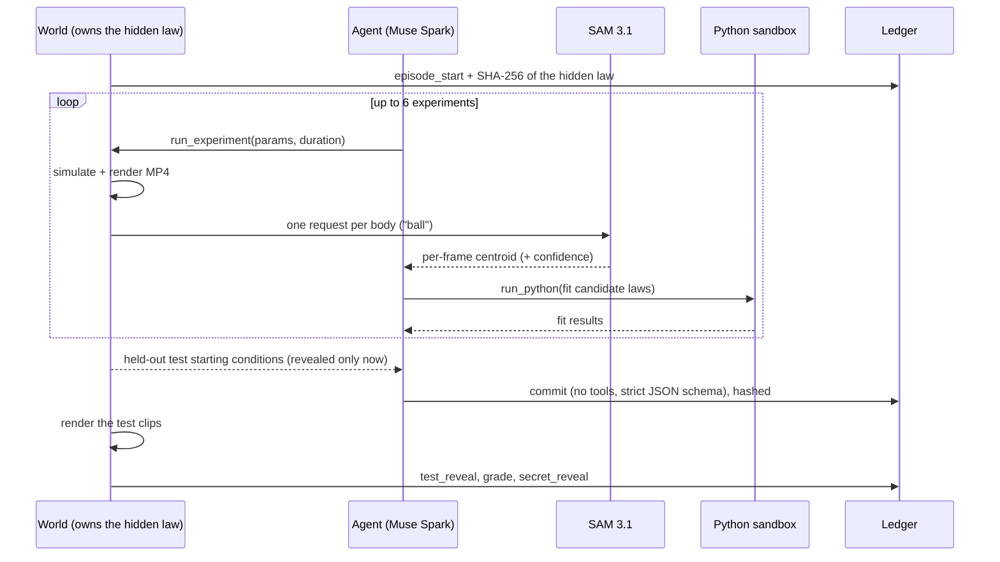

# PhysTax: the perception tax of an AI scientist

An AI agent studies a small universe whose force law is hidden and deliberately
non-textbook. It designs experiments, watches them only through a camera
measured by **SAM 3.1**, fits a law, and **seals a numeric prediction** for
starting conditions it has never tried. Only then does the universe run the test.
The agent is graded on what actually happens. No language model judges anything.

The headline question:

> **How much discovery ability does an AI scientist lose when it has to measure
> the world through a camera instead of being handed exact numbers, and how much
> of that loss can SAM 3.1's own confidence signal buy back?**

That loss is the **perception tax**. This repository is the instrument for
measuring it.

**What this is, and what it is not.** It is not unsupervised learning, and no
model is trained by reinforcement learning here. It is an *evaluation science*
study: an LLM agent does system identification and model selection (which law,
which constants) while its only sensor is a vision model, and we measure how
much the sensor costs. The RL connection is real but downstream: every episode
ends in a verifiable, numeric reward (held-out prediction error), so the same
environment can later train scientist agents with perception in the loop, the
way NewtonBench is now used as an RL environment in NVIDIA NeMo Gym.

Built for the Meta Global AI Developer Hackathon (Push the Frontier theme), Oct 26 to Nov 4, 2026.

---

## Contents

1. [The idea in one minute](#1-the-idea-in-one-minute)
2. [Why this is a real experiment](#2-why-this-is-a-real-experiment)
3. [What is new here](#3-what-is-new-here)
4. [How one episode works](#4-how-one-episode-works)
5. [The three universes](#5-the-three-universes)
6. [The measurement channels](#6-the-measurement-channels)
7. [Grading and why it cannot be gamed](#7-grading-and-why-it-cannot-be-gamed)
8. [How the Meta models are used](#8-how-the-meta-models-are-used)
9. [Status: what has been verified](#9-status-what-has-been-verified)
10. [Quickstart](#10-quickstart)
11. [Repository map](#11-repository-map)
12. [Cost](#12-cost)
13. [Limitations and threats to validity](#13-limitations-and-threats-to-validity)
14. [References](#14-references)

Planning documents: [`docs/build-plan.md`](docs/build-plan.md) (day by day) and
[`docs/demo-script.md`](docs/demo-script.md) (the 3-minute video and live demo).

---

## 1. The idea in one minute

Real science happens through instruments. A physicist never receives the true
position of a particle; they receive a camera frame, a detector count, or a
microscope image, and they have to turn that noisy signal into a measurement
before they can reason about it.

Most benchmarks for "AI scientists" skip that step. The agent asks a simulator
a question and gets back clean numbers. That tests reasoning in a world without
measurement error, which is not the world labs live in.

PhysTax puts the instrument back:

```
agent chooses an experiment
   -> the hidden-law universe runs it and renders a video
   -> SAM 3.1 tracks each object in the video (with per-frame confidence)
   -> the agent fits candidate laws in a Python sandbox
   -> repeat, within a budget
   -> agent seals a prediction for new starting conditions (hashed, logged)
   -> the universe runs the test; a deterministic grader scores the prediction
```

Run the identical episode with exact coordinates instead of the camera, and the
difference in the grade is the perception tax.

## 2. Why this is a real experiment

A demo shows that something works. An experiment asks a question whose answer
could come out either way. Every hypothesis below is decided by numbers the
grader produces, and each has a clear way to be wrong.

| # | Hypothesis | Measured by | It is false if |
|---|---|---|---|
| H1 | A perception tax exists and grows as the camera gets worse | grade under `sam` vs `oracle`, at camera levels 0 to 3 | camera grades match oracle grades |
| H2 | SAM 3.1's confidence is informative about its own error | Spearman correlation between per-frame confidence and centroid error, from `measure_perception` | correlation is near zero or positive |
| H3 | Using confidence recovers part of the tax | `sam_conf` vs `sam`, same videos, same tracks | no improvement, or worse |
| H4 | SAM 3.1 beats a classical tracker on cluttered, degraded scenes | `sam` vs `classical` | classical matches or wins |
| H5 | Most of the tax is measurement, not reasoning (or the reverse) | the decomposition below | either way is a finding |
| H6 | Meta models differ as experimentalists | Muse Spark vs Muse Wonder vs self-hosted Muse Glimmer on identical universes | no difference |
| H7 | AI scientists know how wrong they are | coverage of committed 80% intervals (target 0.80) and the interval score | coverage far from 0.80, or intervals no better than a constant width |

**The decomposition (H5).** A second scientist, the *reference fitter*, is not
an LLM. It is told the correct functional form and only fits constants by
weighted, robust least squares. Running it on three data sets splits every
agent episode exactly:

```
total            = agent(camera, agent's experiments) - ref(oracle, fixed design)

measurement tax  = ref(camera, fixed design)    - ref(oracle, fixed design)
design gap       = ref(camera, agent's data)    - ref(camera, fixed design)
reasoning tax    = agent(camera, agent's data)  - ref(camera, agent's data)
```

The three terms telescope, so they sum to the total for every episode (a test
checks this). The *reasoning tax* compares the agent with a fitter given the
very same measurements, so it isolates what the agent lost by having to find
the form and fit it itself. The *design gap* says whether the agent's choice of
experiments helped or hurt compared with a fixed sensible design. Medians are
reported with 95% bootstrap intervals; comparisons are paired, because every
universe is run under every channel.

**Pre-registration, twice.** Each prediction is hashed into an append-only
ledger before its test exists. The benchmark protocol itself (grid, seeds,
channels, models) is hashed with `run_bench protocol` before the full runs, so
the README can show the analysis was fixed before the results came in.

**H3 might fail.** That is fine and worth reporting. The Day-2 measurement (H2)
decides early whether H3 is worth chasing at all; see the build plan.

## 3. What is new here

Recent work has pieces of this, but not the whole loop.

**Side by side with NewtonBench** (read from its repository):

| | NewtonBench (ICLR 2026) | PhysTax |
|---|---|---|
| Scale | 324 tasks, 12 physics domains | 3 systems × 2 forms, continuous constants per seed |
| How laws are hidden | a fixed menu of shifted laws (e.g. r^-1.5, r^-2.6) | structurally different forms, constants and exponents drawn per seed |
| What the agent observes | numbers from the apparatus, optionally with injected relative noise | video, measured by SAM 3.1 (or the controls) |
| Closest task | an orbital system that returns tracked positions and velocities | `central_power`: the same experiment, but positions come from a camera |
| Grading | RMSLE on held-out data plus an LLM judge for symbolic equivalence | purely numeric: held-out trajectory error, no judge |
| Noise finding | its README reports a 13–15% accuracy drop from noise as small as 0.0001 | the question here: what does *real* perception noise cost? |

That last row is the bridge: NewtonBench shows discovery is fragile to
synthetic noise; PhysTax measures the noise a real vision model produces.

- **Interactive law discovery with clean numbers.** NewtonBench (ICLR 2026)
  has agents run experiments in simulators where physical laws have been
  changed. DiscoverPhysics reports that even strong frontier models solve only
  about half its worlds. MaD Physics and CausaLab are in the same family. In all
  of them the agent receives exact simulator output.
- **Law discovery from pixels, without experimenting.** Pixel2Phys (CVPR 2026)
  distills governing equations from video, but it analyses existing footage and
  never chooses what to run next.
- **Meta's own framing.** Meta's math work with Muse Spark lives in a formally
  verifiable domain; its health-data work describes supervised research agents
  in domains whose findings cannot be formally verified. Physical
  experimentation sits between them: claims are verified empirically, by
  predicting before observing.

We did not find published work that closes the loop through a camera
(design, act, measure with a segmentation model, refit) and splits the
resulting loss into measurement and reasoning. That is the contribution. If you
find prior work that does, cite it in the write-up and sharpen the claim; do
not hide it.

Why it matters outside a benchmark: self-driving labs, robotics teams building
simulators from video of real objects, and engineering test rigs all estimate
physical parameters from cameras. Knowing how much a vision model's errors cost
downstream, and whether its confidence can be trusted to weight data, is a
practical question for all of them.

## 4. How one episode works



Why two phases: the Meta Model API accepts `tool_choice: "auto"` only, so a
final "commit" tool cannot be forced. Exploration ends when the model stops
calling tools or runs out of budget; the commitment is a separate call with
tools removed and a strict `json_schema` response format. That separation is
also the safer design: the model cannot keep acting after it has committed.

An optional reviewer step (Muse Wonder) reads the draft commitment and the
evidence and may send it back once for revision before it is sealed. Running
with and without the reviewer is itself an ablation.

## 5. The three universes

Each system has two structurally different hidden laws. Per seed the world
picks one and draws its constants, so the agent must choose the law (model
selection) as well as fit it (system identification). The agent is never told
the form, its parameter names, or even the internal family id (it sees neutral
names: orbit, projectile, tethered block); a test enforces this.

| System | Form A | Form B |
|---|---|---|
| orbit (`central_power`) | power law `a = -k r^(-alpha)`, alpha in [1.3, 3.1] | screened `a = -k exp(-r/lam) / r^2`, lam in [70, 260] px |
| projectile (`power_drag`) | gravity g in [120, 520] px/s², drag `gamma |v|^beta`, beta in [1.15, 2.6] | gravity g, drag `c1 |v| + c2 |v|^2` (Stokes + Newton) |
| tethered block (`nonlinear_spring`) | `x'' = -k x - c x^3 - b x'` (viscous loss) | `x'' = -k x - c x^3 - mu sign(x')` (dry friction) |

A wrong form shows up as wrong predictions on the held-out tests, so no judge
is needed. Parameter recovery is scored against the true form's constants.

The agent controls only the experiment parameters (launch speed, angle,
distance, displacement), within bounds. It never sets the test conditions; the
world picks those and reveals them at commit time.

Rendering is domain-randomized on purpose: textured backgrounds, shaded
objects, and static decoys that share the moving objects' colours. On flat
coloured discs a colour threshold would track perfectly and SAM would be
decoration. Camera levels add noise, motion blur, resolution loss, flicker, an
occluding pillar and dropped frames (`phystax/sim/degrade.py`).

## 6. The measurement channels

The same universe and the same experiments, seen five ways:

| Channel | What the agent receives | Why it is there |
|---|---|---|
| `oracle` | exact simulator coordinates | the ceiling |
| `noisy_oracle` | exact coordinates + Gaussian noise | separates plain noise from SAM-specific failures (dropouts, decoys, occlusion) |
| `sam` | SAM 3.1 tracks, confidence hidden | the camera |
| `sam_conf` | SAM 3.1 tracks with per-frame confidence | tests H3 |
| `classical` | median background subtraction | the non-foundation-model baseline |

`sam` and `sam_conf` share one cached SAM call per video (confidence is always
requested, then hidden for `sam`), so the comparison is exact and costs half.

## 7. Grading and why it cannot be gamed

- **No LLM judge.** The grader compares committed numbers with the simulator's
  trajectory: normalised RMSE of predicted positions at six probe times, plus
  relative error on each scored constant. A run passes under 5% error.
- **Uncertainty is graded too.** Every predicted point comes with a central 80%
  interval. These are scored with the interval score (Gneiting & Raftery 2007),
  a proper scoring rule: you minimise it only by reporting your true
  uncertainty, so overconfident and needlessly vague intervals both lose. We
  also report coverage, which should be about 0.80 for a calibrated scientist.
  The reference fitter derives its intervals from its own fit: it samples the
  constants from the least-squares (Laplace) covariance and simulates each.
- **Repeatability.** `--repeats K` runs K independent attempts per universe and
  reports pass@1 and pass@K, so a single lucky or unlucky run cannot carry a
  claim (motivated by Meta's *Sharpening Tax*, which shows single-shot and
  many-attempt performance can diverge).
- **The law is sealed at the start.** The world publishes a SHA-256 of the
  hidden law before the first experiment and reveals the law only after grading,
  so anyone can check it did not change.
- **Commit before test.** The ledger is hash-chained; editing or reordering
  any entry breaks `verify()`, and `commit_precedes_test()` checks the order.
  The UI has a "Verify the ledger" button.
- **Held-out tests.** Test starting conditions are chosen by the world and
  shown only at commit time, so the agent cannot run them as experiments.
- **No path to the secret.** The agent's only tools are `run_experiment` and
  `run_python`. The sandbox directory contains only what the agent was shown.
  The local sandbox is a subprocess (good for development); for the public
  demo, move it to a Modal sandbox so containment is enforced by the platform.

## 8. How the Meta models are used

Every model has a job that would break the system if removed.

| Model | Role | Why it is load-bearing |
|---|---|---|
| **SAM 3.1** (Meta Model API) | the measuring instrument | the only way the agent sees camera-condition experiments; its confidence is the variable in H2 and H3 |
| **Muse Spark 1.3** | the experimentalist | designs experiments, writes fitting code, commits predictions |
| **Muse Spark Open** (Baseten, `meta-models/muse-spark-open-1026`) | second experimentalist | the open-weight arm of H6 (and the open-weight bonus prize) |
| **Muse Wonder** | independent reviewer | challenges the draft before it is sealed; with/without is an ablation |
| **Muse Glimmer 30B** (self-hosted on our own H100) | third experimentalist, text and tools only | the agent receives numbers, not pixels, so Glimmer can take part without vision; this is the open-weight entry, with provenance logs |
| ~~Muse Image~~ | not used | Meta's Geographic Use Policy bars Muse Image in India (access from India, and serving Indian end users). The renderer is procedural; optional realistic sprites are cut from CC0 photos with SAM 3.1 itself (see the build plan) |
| **Muse Code** | the build harness | used to build and test this repo; the runtime ledger follows the cookbook's append-only audit-log design |

API facts this code relies on, checked against Meta's docs and cookbooks:

- SAM takes **one short noun phrase per request**; lists return zero matches.
  It can also take box and point prompts (not used yet).
- `metadata` values are strings: `include_confidence: "true"`,
  `mask_encoding: "one_bit"`. Box and point prompts always return one-bit masks.
- Mask payloads are **base85**, not base64; always decode with the official
  `meta_sam_parser` (`decode_mask_to_raster`). This repo never parses the wire
  format by hand.
- A completed request with no matches is valid, not an error.
- Video: MP4 or MOV (H.264, H.265, MPEG-4), up to 15,000 frames, up to 16
  tracked objects, billed per frame with a **50-frame minimum**. Results can vary
  slightly between identical requests, so every SAM call is cached by content
  hash for deterministic replay.
- Muse Spark tool calling accepts `tool_choice: "auto"` only; `json_schema`
  structured output works on chat completions.
- Muse Image is not available in India under Meta's Geographic Use Policy
  (https://dev.meta.ai/legal/geographic-use-policy), so this project does not
  use it, and does not route around the restriction.
- Muse Glimmer is text and tool calling in Meta's own cookbook today; vision is
  listed as coming later. The Glimmer RL recipe in the cookbook was verified on
  8×H100, so it is out of scope here.

## 9. Status: what has been verified

**Verified offline (no API keys), with tests in `tests/`:**

- Simulation is deterministic per seed; hidden constants are non-textbook.
- Renderer writes H.264 `+faststart` MP4s that SAM's format rules accept.
- The reference fitter recovers every hidden constant from exact coordinates
  (error around 1e-6) and stays within about 1% with 3-pixel noise.
- The classical tracker degrades in the expected places: it keeps the
  projectile roughly right, but mistracks the spring (tether line, decoys) and
  cannot see the fixed planet at all (it is part of the background). The
  pilot table below has the numbers.
- The two-phase loop, the ledger, the grader, and the web UI run end to end
  with a scripted model and with the synthetic SAM stand-in.

**Not yet verified (needs your keys; this is Days 1 to 3):**

- Real SAM 3.1 latency, confidence behaviour and accuracy on these renders.
- Real Muse Spark / Spark Open tool-calling behaviour in this loop
  (`reasoning_effort` and `json_object` acceptance are assumptions to check).

### Offline pilot (reference fitter, no LLM)

Generated with:
`python -m phystax.bench.run_bench reference --levels 0 3 --seeds 2 --conditions oracle noisy_oracle classical`.
Median normalised prediction error on held-out tests (lower is better), n = 2
seeds per cell. A pilot to show the instrument works, not a result. It was run
before the second hidden form was added (single form per system), so treat it
as v0.

| System | Camera level | oracle | noisy_oracle | classical |
|---|---|---|---|---|
| central_power (orbit) | 0 | 0.0000 (2/2 pass) | 0.0017 (2/2) | 0.0893 (1/2) |
| central_power (orbit) | 3 | 0.0000 (2/2) | 0.0017 (2/2) | 0.5360 (0/2) |
| nonlinear_spring | 0 | 0.0000 (2/2) | 0.0005 (2/2) | 0.1209 (0/2) |
| nonlinear_spring | 3 | 0.0000 (2/2) | 0.0005 (2/2) | 0.1631 (0/2) |
| power_drag (projectile) | 0 | 0.0000 (2/2) | 0.0004 (2/2) | 0.0132 (2/2) |
| power_drag (projectile) | 3 | 0.0000 (2/2) | 0.0004 (2/2) | 0.0149 (2/2) |

Reading it: random noise alone costs almost nothing; a classical tracker fails
on the orbit (the fixed planet is invisible to background subtraction) and the
spring (tether line, decoys), but is fine on the projectile. SAM 3.1 columns are
added once API access is live.

## 10. Quickstart

### Install

Python 3.10+ and **ffmpeg on your PATH** (Windows: `winget install Gyan.FFmpeg`,
then open a new terminal; macOS: `brew install ffmpeg`).

```bash
python -m venv .venv
# Windows: .venv\Scripts\activate    macOS/Linux: source .venv/bin/activate
pip install -r requirements.txt
pytest -q            # 20 offline tests, no keys needed (about 5 minutes)
```

### Try everything offline first

```bash
# Windows PowerShell:  $env:PHYSTAX_SAM_BACKEND="synthetic"
export PHYSTAX_SAM_BACKEND=synthetic
uvicorn phystax.web.app:app --port 8000
# open http://localhost:8000, choose "Reference fitter (no LLM)", run
```

The synthetic backend imitates SAM's output shape from simulator truth. It
exists so you can build and rehearse before credits arrive. Results made with it
are tagged, shown with a warning in the UI, and excluded from the report.

### With real keys

1. On dev.meta.ai, add a payment method (requests are refused without one,
   even on hackathon credits), then create an API key.
2. Copy `.env.example` to `.env`, fill in `MODEL_API_KEY` (and
   `BASETEN_API_KEY`), and export them in your shell.
3. Run, in this order:

```bash
python scripts/day1_llm_smoke.py                                   # Day 1: chat, tools, schema, tier, price
python scripts/day1_sam_smoke.py                                   # Day 1: does SAM work on our renders?
python -m phystax.budget                                           # spend so far vs the cap
python -m phystax.bench.measure_perception --seeds 3               # Day 2: H2 and H4
python -m phystax.bench.run_bench protocol --seeds 4 --levels 0 2 3  # freeze the grid
python -m phystax.bench.run_bench reference --seeds 4 --levels 0 2 3
python -m phystax.bench.run_bench agent --models spark spark-open --conditions oracle sam sam_conf --seeds 4 --levels 2
python -m phystax.bench.report                                     # tables for the write-up
uvicorn phystax.web.app:app --port 8000                            # the live lab
```

The UI plays H.264 video, so use Chrome, Edge or Safari for the demo.

### Self-hosted Muse Glimmer (open-weight arm)

Follows Meta's cookbook: a dedicated vLLM image (plain `pip install vllm` will
not serve it), about 72 GB of VRAM, and both tool-call and reasoning parsers.
Use only a GPU you are allowed to use.

```bash
nvidia-smi                                   # pick a free GPU
bash scripts/serve_glimmer.sh 0              # serves on 127.0.0.1:8000; log -> runs/provenance/
python scripts/glimmer_check.py              # chat, tools, schema checks + provenance snapshots
python -m phystax.bench.run_bench agent --models glimmer --conditions oracle --seeds 1 --levels 0
```

Every Glimmer benchmark run writes a provenance snapshot (git commit, GPU,
served model list) to `runs/provenance/`, next to the full vLLM server log.
Commit the ones you cite with `git add -f`.

## 11. Repository map

```
phystax/
  config.py               model ids, endpoints (loads .env automatically)
  budget.py               prices, pre-call checks, hard spend caps
  doctor.py               environment self-check
  sim/
    laws.py               the three hidden-law families
    engine.py             RK4 integrator with contact rules
    render.py             domain-randomized H.264 MP4 renderer (uses assets/ if present)
    degrade.py            camera levels 0-3
    world.py              owns the secret; experiments; held-out tests
  perception/
    sam_client.py         SAM 3.1 via Files + Responses API, cached
    tracks.py             parser records -> per-body tracks, decoy rejection, confidence-error correlation
    classical.py          background-subtraction baseline
    synthetic_sam.py      offline stand-in (never reportable)
  agent/
    providers.py          Meta API, Baseten, local servers behind one client
    tools.py              run_experiment, run_python
    sandbox.py            subprocess sandbox
    prompts.py            experimentalist and reviewer prompts
    loop.py               explore -> sealed commit -> optional review -> grade
  grader/
    ledger.py             hash-chained JSONL
    grade.py              commitment schema and deterministic scoring
  bench/
    conditions.py         the five measurement channels
    reference.py          the reference fitter
    measure_perception.py H2/H4 instrument study
    run_bench.py          protocol | reference | agent
    report.py             tables, including the tax decomposition
  web/
    app.py, static/index.html   live lab and replay UI
scripts/day1_llm_smoke.py, scripts/day1_sam_smoke.py
tests/                    20 offline tests
docs/build-plan.md, docs/demo-script.md
assets/                   optional backgrounds/ and sprites/ (CC0 photos; sprites cut out with SAM 3.1)
```

## 12. Cost and the budget guard

Prices from the Meta Model API Models tab (Oct 28, 2026), per 1M tokens:

| Model | Input | Cached input | Output |
|---|---|---|---|
| Muse Spark 1.3 | $1.25 | $0.15 | $4.25 |
| Muse Spark 1.3 Contributor | $0.10 | $0.002 | $0.20 |
| Muse Wonder 1.0 | $4.00 | $0.20 | $20.00 |
| SAM 3.1 video | $0.20 per 1,000 frames (50-frame minimum) | | |

`phystax/budget.py` checks the estimated cost of every chat and SAM call before
sending it and records the real cost after, in `runs/spend.jsonl`. It refuses
calls that would cross the cap (default $120 of the $150 Meta credits, and $90
of the $100 Baseten credits). `python -m phystax.budget` prints the running
total. The contributor tier is about 12× cheaper; it is "available in select
countries", so the agent tries it first and falls back to standard once if
refused. While free credits are in use, content may be used for product
improvement on either tier, so contributor costs nothing extra in privacy.

Rough plan for the $150, assuming the standard tier (contributor is far cheaper):

| Phase | Calls | Estimate |
|---|---|---|
| Day 1 smoke tests | 4 SAM clips + ~6 chat calls | < $0.50 |
| Day 2 perception study | ~140 SAM requests (3 seeds × 4 levels) | ~ $3 |
| Agent grid, Muse Spark | 36 episodes (3 systems × 4 seeds × 3 channels) | ~ $15–25 |
| Wonder reviewer ablation | 12 reviews | ~ $1–2 |
| Reruns, demo, buffer | | the rest |

Every SAM call is cached by content hash, so reruns and replays cost nothing.

For bulk benchmark runs, the Muse Spark contributor tier is much cheaper per
token; Meta may train on that traffic, which is acceptable for synthetic physics
data. Use the standard tier for the live demo. Note that a Muse Code
subscription defaults to contributor terms unless you change the account
setting.

## 13. Limitations and threats to validity

- **Synthetic renders are not real footage.** The scenes are designed to be
  hard, but they are still renders. The claim is about measurement through a
  vision model under controlled degradation, not about real lab footage.
- **Static camera.** Background subtraction benefits from it; that is why the
  classical baseline is included rather than ignored.
- **The reference fitter knows the true form.** That is intended: it isolates
  measurement error. It is not a fair competitor to the agent on form discovery.
- **Small n.** With a 10-day window, expect around 4 seeds per cell. Report
  medians with ranges and say how many runs each number comes from.
- **Run-to-run variance in SAM.** Cached for replay; a separate run quantifies it.
- **The sandbox is a subprocess.** Fine for a benchmark you run yourself; use a
  platform sandbox for anything public.

## 14. References

- Meta, *Segmenting with prompts* (SAM 3.1 API): https://dev.meta.ai/docs/sam/segmenting
- Meta, *meta-sam* protocol and parsers: https://github.com/meta-models/meta-sam
- Meta, *meta-model-cookbook*: https://github.com/meta-models/meta-model-cookbook
- Meta, *meta-oss-cookbook* (Muse Spark Open, Muse Glimmer): https://github.com/meta-models/meta-oss-cookbook
- Meta, *Pricing and rate limits*: https://dev.meta.ai/docs/pricing-rate-limits
- Meta AI Research, *Solving Open Research Problems Together*: https://research.meta.ai/blog/solving-open-research-problems-together
- Meta AI Research, *Accelerating Scientific Research in Health Data Science With Muse Models*: https://research.meta.ai/blog/accelerating-scientific-research-in-health-data-science-with-muse-models
- Meta AI Research, *The Multimodal Intelligence of Muse Spark 1.2*: https://research.meta.ai/blog/multimodal-intelligence-of-muse-spark-1-2
- NewtonBench (ICLR 2026): https://github.com/HKUST-KnowComp/NewtonBench
- DiscoverPhysics: https://arxiv.org/abs/2605.26087
- MaD Physics: https://arxiv.org/pdf/2605.10820
- CausaLab: https://arxiv.org/pdf/2605.26029
- Pixel2Phys (CVPR 2026): https://arxiv.org/html/2602.19516
- Predictive Credit: Measuring What Scientific Explanations Add to Experimental Forecasts (CMU, 2026): https://huggingface.co/papers/2610.00314
- Sharpening Tax in Post-Training (Meta, 2026): https://huggingface.co/papers/2610.01509
- Gneiting & Raftery, Strictly Proper Scoring Rules, Prediction, and Estimation (JASA, 2007)
